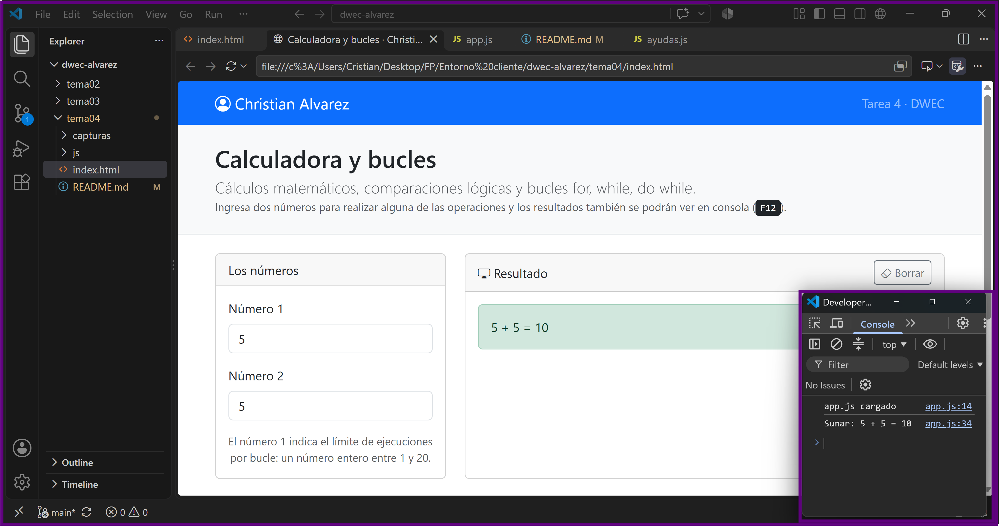
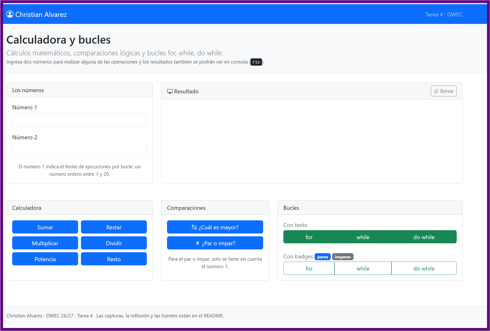
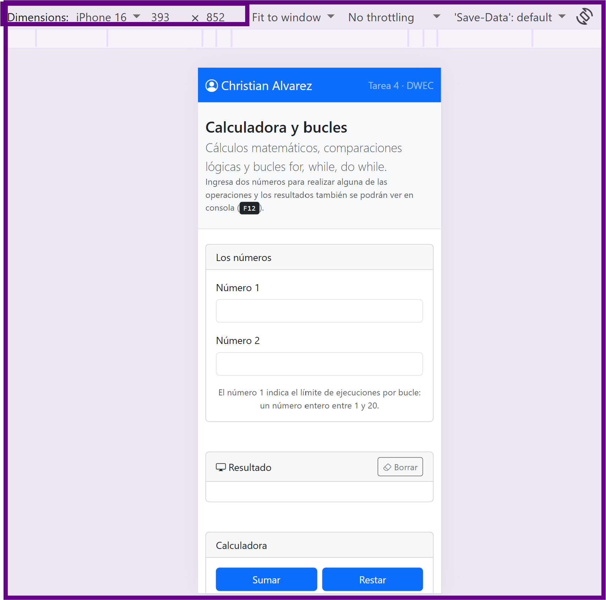
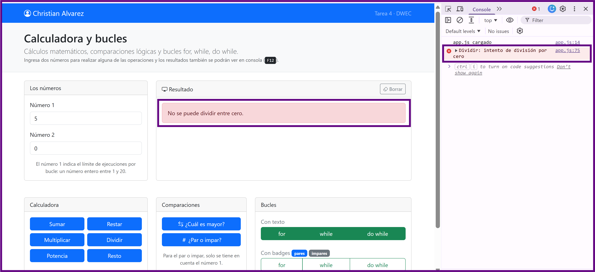
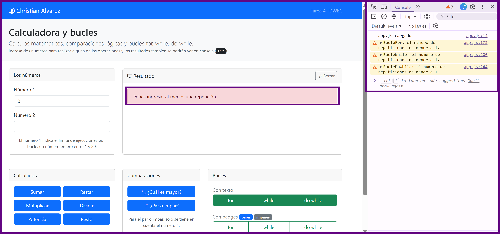
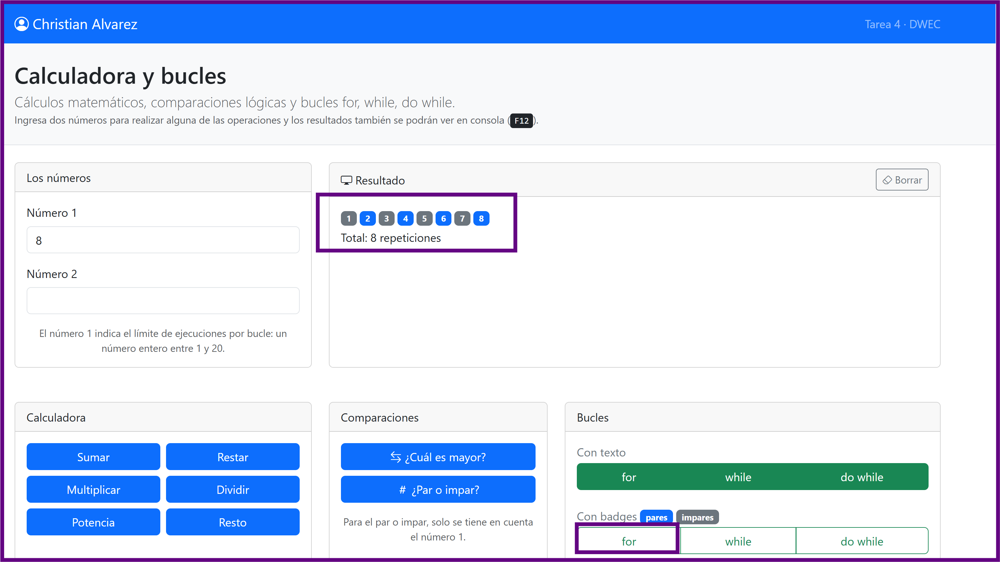

# Tarea 4 · Calculadora y bucles

**Autor:** Christian Alvarez · Desarrollo Web en Entorno Cliente (DWEC) · 2.º DAW · Curso 2026-27

<!-- **Plantilla de la tarea 4.** Cómo usarla:
>
> 1. Copia esta carpeta en tu repositorio de DWEC y cámbiale el nombre a `tema04`.
> 2. `index.html` trae lo imprescindible para empezar: las dos casillas, la zona de resultado y el botón «Sumar». El resto de la página y su maquetación con Bootstrap los haces tú.
> 3. `js/app.js` trae `sumar()` hecha como modelo y las demás funciones con `TODO`.
> 4. `js/ayudas.js` no se toca: son las funciones que leen las casillas y escriben el resultado.
> 5. Sustituye las imágenes de `capturas/` por las tuyas, **con el mismo nombre**.
> 6. Todo lo que va entre [corchetes] es un hueco: cámbialo por lo tuyo. Al terminar, borra este aviso.-->

En la carpeta tema04 se encuentra el index.html junto con el README.md, una carpeta js que contiene los codigos javaScript app.js y uno de ayudas.js, adicional una carpeta con capturas para el README.md.

## Capturas

### a) La página entera

En la captura se puede ver la barra de navegación con mi nombre, las cards con las rejillas se han distrinuido con una fila donde las dos cards superiores han resivido el tamaño de columna lg-4 y lg-8 y las inferiores han recibido lg-4, lg-3 y lg-5 cada una, de esta manera las dos primeras que summan 12 se posicionan arriba y las otras 3 cards (Que también suman 12) quedan justo debajo.
Cada card se le asigna col-12 cuando no son lg, así queda distribuido hacia abajo cuando esta en el modo movil.

### b) La página en el móvil

En version movil, los cards se desplazan hacia abajo.

### c) El error de dividir entre 0

En la pagina el usuario ve un mensaje en el que se le indica que no se puede dividir por 0 y en la consola un mensaje para el desarrollador con el warning indicando que se intento dividir por 0.

### d) Los tres bucles con el número 0

Para los tres bucles se ha puesto una condición de que el numero ingresado debe ser 1 o mayor que se muestra por pantalla y en la consola.
Sin la condición los bucle for y while no mostrarian repetición y el doWhile una repetición.

### e) Un bucle con badges

Se ha introducido el número 8, y la función recorre las 8 iteraciones mostrando badges numerados del 1 al 8 y utiliza el operador ternario (i % 2 === 0) ? "primary" : "secondary", para asignar el color azul primary que son los numeros pares y el color gris secondary a los impares.

## Reflexión

La diferencia entre los bucles radica cuándo se evalúa la condición de parada y cuántas veces se debe ejecutar. 
El bucle for se utiliza cuando se conoce de antemano el número exacto de iteraciones.
El bucle while evalúa la condición al principio y se ejecuta mientras esta sea verdadera.
El bucle do...while evalúa la condición al final, lo que permite que el bloque de código se ejecute al menos una vez, por esto al probar con el número 0, el for y while no llegan a ejecutar, pero el do...while se ejecutaría una vez.

## Fuentes

- [MDN Web Docs - Bucle For](https://developer.mozilla.org/es/docs/Web/JavaScript/Guide/Loops_and_iteration#bucle_for)
- [MDN Web Docs - Bucle While](https://developer.mozilla.org/es/docs/Web/JavaScript/Guide/Loops_and_iteration#bucle_while)
- [MDN Web Docs - Bucle Do...While](https://developer.mozilla.org/es/docs/Web/JavaScript/Guide/Loops_and_iteration#bucle_dowhile)
- [Bootstrap 5 Documentation - Grid System](https://getbootstrap.com/docs/5.3/layout/grid/)
- [Bootstrap 5 Documentation - Cards](https://getbootstrap.com/docs/5.3/components/card/)
- [Bootstrap Icons - Official Library](https://icons.getbootstrap.com/)

## Uso de IA

Se ha utilizado Gemini como asistente de soporte durante el desarrollo de la práctica. Se empleó para resolver dudas puntuales sobre la sintaxis de las clases del grid de Bootstrap, validar la lógica de las funciones condicionales.