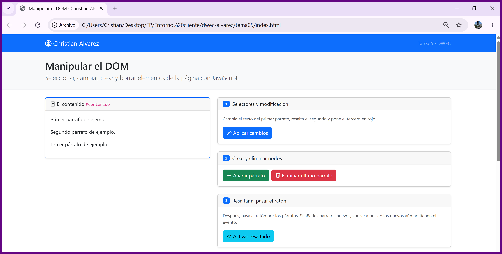
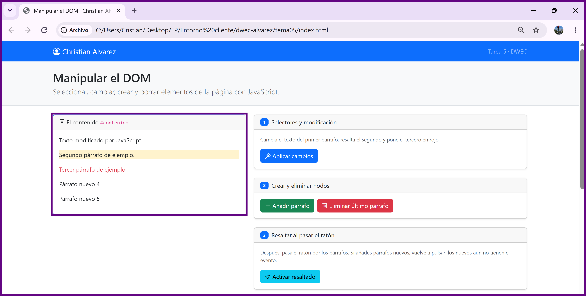
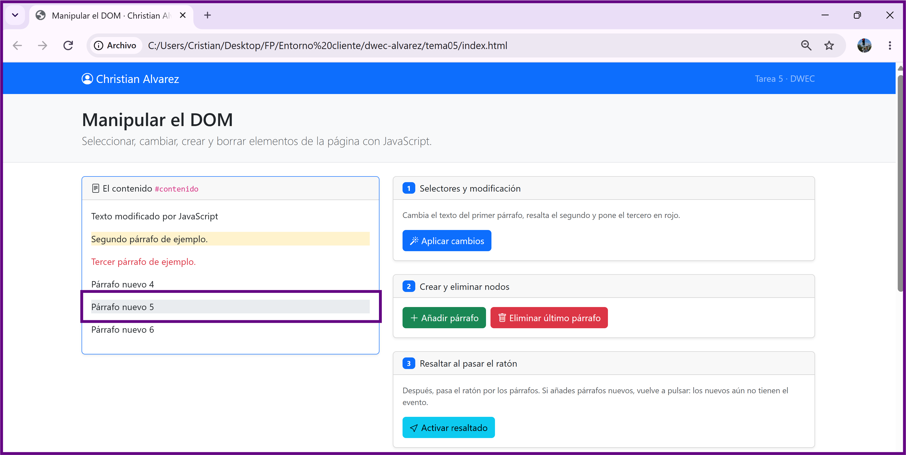
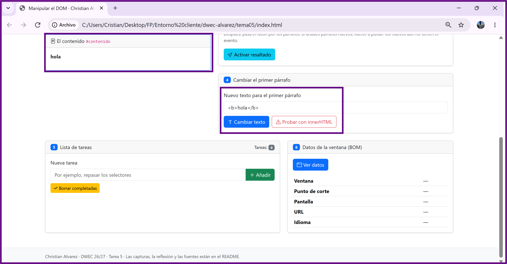
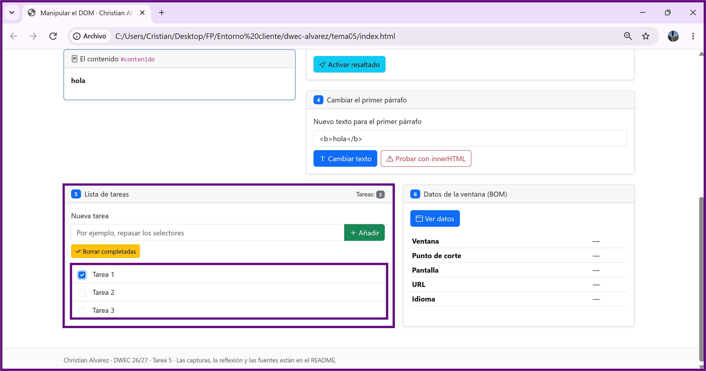
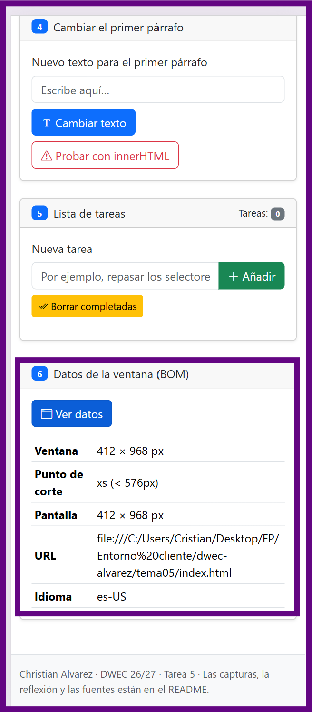

# Tarea 5 · Manipular el DOM

**Autor:** Christian Alvarez · Desarrollo Web en Entorno Cliente (DWEC) · 2.º DAW · Curso 2026-27

<!-- **Plantilla de la tarea 5.** Cómo usarla:
>
> 1. Copia esta carpeta en tu repositorio de DWEC y cámbiale el nombre a `tema05`.
> 2. `index.html` ya está maquetado: es la página que vas a manipular. No cambies los `id` ni las clases que usa el JavaScript.
> 3. `js/app.js` trae una función por botón con `TODO`, y modelos en los ejercicios 1, 3 y 6.
> 4. Sustituye las imágenes de `capturas/` por las tuyas, **con el mismo nombre**.
> 5. Todo lo que va entre [corchetes] es un hueco: cámbialo por lo tuyo. Al terminar, borra este aviso.-->

Esta carpeta contiene la solución a la Tarea 5 sobre manipulación del DOM y el BOM mediante JavaScript, para ejecutar la aplicación, abrir el proyecto en VS Code, iniciar el servidor con **Go Live** (Live Server) y abrir la consola del navegador (F12) para comprobar los rastros del código.

## Capturas

### a) La página recién cargada

En esta imagen se observa la interfaz inicial con el nombre Christian Alvarez en la barra de navegación, la estructura basada en Bootstrap y los tres párrafos de prueba iniciales cargados en el contenedor `#contenido`.

### b) Ejercicios 1 y 2

Muestra el resultado tras pulsar "Aplicar cambios" y añadir dos párrafos nuevos. El primer párrafo cambia su texto por ID (`#primero`), el segundo resalta con fondo amarillo mediante su clase (`.segundo`) y el tercero se pone en rojo usando `querySelectorAll("#contenido p")`. Además, se muestran los nuevos párrafos creados dinámicamente.

### c) Ejercicio 3: resaltado al pasar el ratón

Muestra un párrafo resaltado con el fondo gris de Bootstrap (`bg-body-secondary`) al pasar el cursor sobre él gracias a los eventos `mouseenter` y `mouseleave`. Los párrafos añadidos tras pulsar el botón "Activar resaltado" no tendrán el evento activo hasta que se vuelva a pulsar el botón.

### d) Ejercicio 4: `<b>hola</b>` con innerHTML

Al escribir `<b>hola</b>` y usar el botón con `textContent`, la etiqueta HTML se imprime literalmente como texto sin formatear. En cambio, al usar el botón con `innerHTML`, el navegador interpreta las etiquetas e imprime la palabra **hola** en negrita.

### e) Ejercicio 5: la lista de tareas

Se visualiza la lista de tareas dinámica creada mediante elementos `<li>`, checkboxes `<input>` y etiquetas ``. Se observan tres tareas ingresadas, con una de ellas marcada como completada y el contador de tareas actualizado.

### f) Ejercicio 6: los datos de la ventana en el móvil

Captura tomada emulando la vista de un dispositivo móvil (p. ej. pantalla < 576px) desde la herramienta de desarrollo. Muestra cómo el punto de corte detectado por la lógica de JavaScript cambia a `xs (< 576px)`, a diferencia de la resolución de escritorio (`lg`, `xl` o `xxl`).

## Reflexión

La principal diferencia entre `textContent` e `innerHTML` radica en cómo procesan la cadena de texto asignada. `textContent` trata cualquier valor estrictamente como texto plano, escapando automáticamente cualquier carácter especial de HTML; por ello, si asignamos `<b>hola</b>`, el navegador muestra las etiquetas de manera literal en pantalla. Por el contrario, `innerHTML` analiza el texto como código HTML y lo interpreta, renderizando los elementos del DOM representados.

## Fuentes

- [MDN Web Docs · Document Object Model (DOM)](https://developer.mozilla.org/es/docs/Web/API/Document_Object_Model)
- [MDN Web Docs · Element.textContent](https://developer.mozilla.org/es/docs/Web/API/Node/textContent)
- [MDN Web Docs · Element.innerHTML](https://developer.mozilla.org/es/docs/Web/API/Element/innerHTML)
- [Bootstrap v5.3 · Documentation](https://getbootstrap.com/docs/5.3/getting-started/introduction/)

## Uso de IA

Se ha utilizado un modelo de IA (Gemini) como asistente para el desarrollo del script `js/app.js`, y verificando las buenas prácticas de manipulación del DOM. Posteriormente, se han revisado las funciones, adaptando las respuestas e integrando las aclaraciones en este documento `README.md`.
