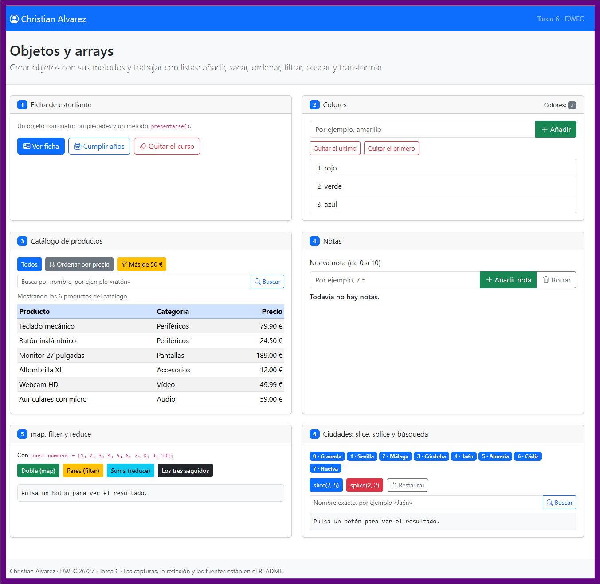
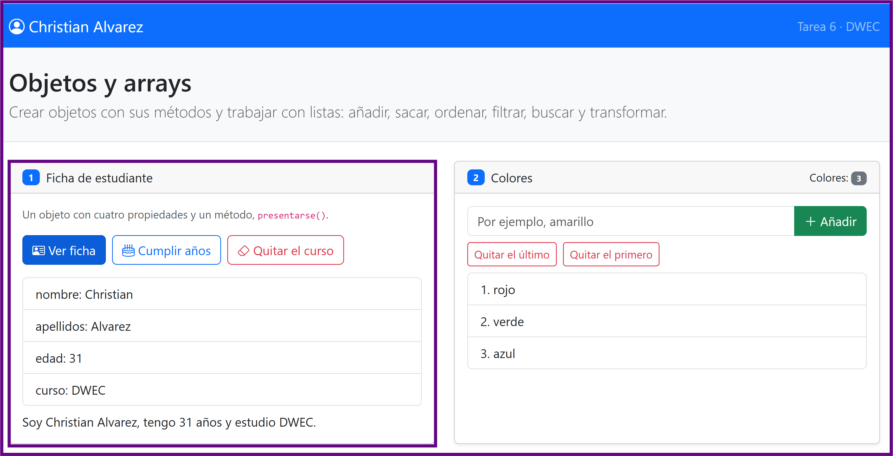
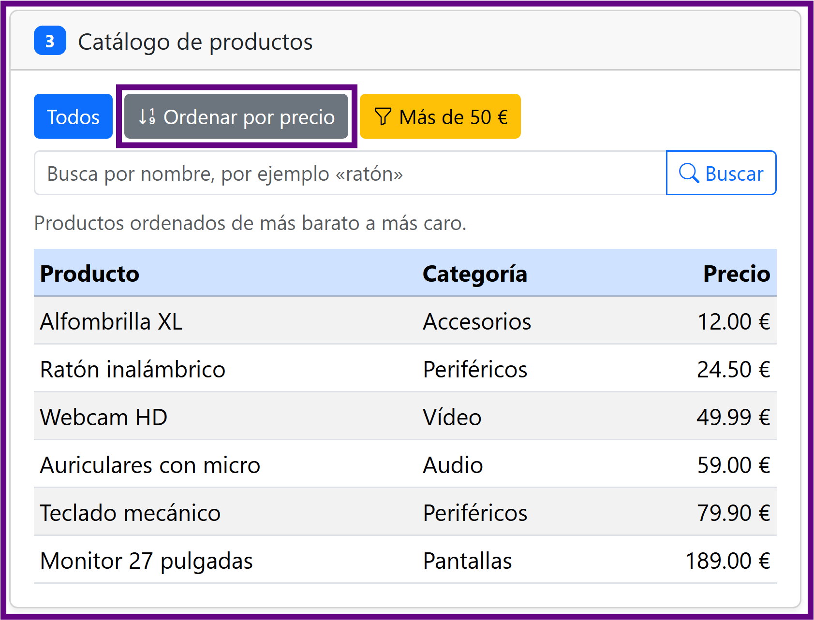
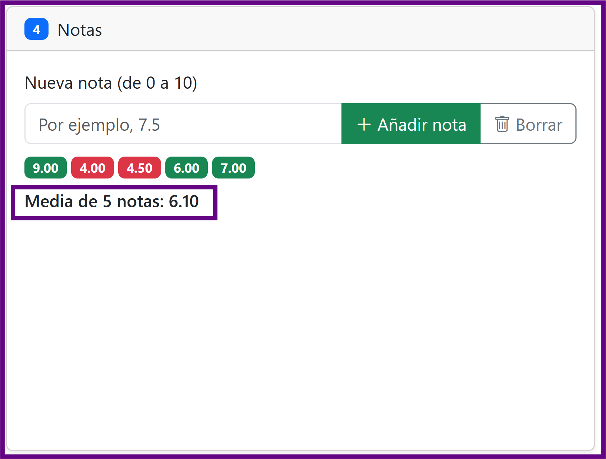
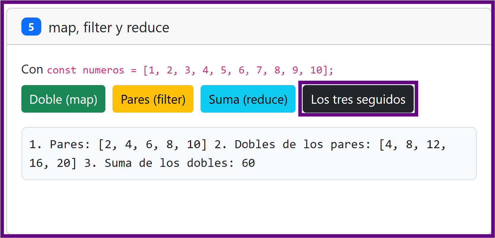
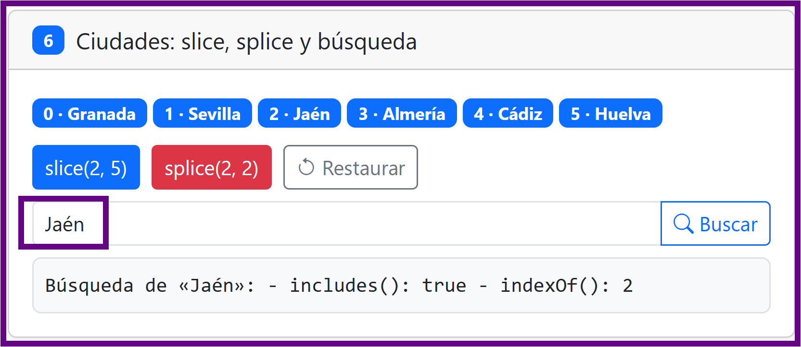

# Tarea 6 · Objetos y arrays

**Autor:** Christian Alvarez · Desarrollo Web en Entorno Cliente (DWEC) · 2.º DAW · Curso 2026-27

<!-- **Plantilla de la tarea 6.** Cómo usarla:
>
> 1. Copia esta carpeta en tu repositorio de DWEC y cámbiale el nombre a `tema06`.
> 2. `index.html` ya está maquetado: seis tarjetas, una por ejercicio. No cambies los `id` ni el `onclick` de los botones.
> 3. `js/app.js` trae una función por botón con `TODO`. Ya están hechas `comoTexto()`, `pintarProductos()` y casi todo el ejercicio 2: úsalas de modelo.
> 4. Todas las funciones con `function`: en esta tarea, sin funciones flecha.
> 5. Sustituye las imágenes de `capturas/` por las tuyas, **con el mismo nombre**.
> 6. Todo lo que va entre [corchetes] es un hueco: cámbialo por lo tuyo. Al terminar, borra este aviso.-->

Esta carpeta contiene la Tarea 6 de DWEC sobre objetos, arrays y manipulación del DOM. Para visualizar la aplicación, abre la carpeta en VS Code, inicia el servidor o con **Go Live** en `index.html` y abre las herramientas de desarrollo (**F12**) para revisar el rastro en la consola (`console.log`).

## Capturas

### a) La página recién cargada

La página de inicio muestra el nombre «Christian Alvarez» en la navbar. Se renderizan automáticamente los 3 colores iniciales en el Ejercicio 2, el catálogo completo de 6 productos en el Ejercicio 3, el estado inicial sin notas en el Ejercicio 4 y las 8 ciudades andaluzas con su correspondiente índice en el Ejercicio 6.

### b) Ejercicios 1 y 2: la ficha y los colores

* **Ejercicio 1:** Al pulsar «Ver ficha», se genera una lista `<ul>` recorriendo las propiedades (`nombre`, `apellidos`, `edad`, `curso`) con `forEach` y se muestra el mensaje retornado por el método `presentarse()`. Tras pulsar «Cumplir años», se incrementa `estudiante.edad` en 1. Al pulsar «Quitar el curso», se ejecuta `delete estudiante.curso`; al volver a pintar, la propiedad aparece como `undefined`.
* **Ejercicio 2:** Se usan `push()` para añadir colores al final de la lista, `pop()` para extraer y devolver el último elemento, y `shift()` para extraer y devolver el primer elemento.

### c) Ejercicio 3: el catálogo ordenado por precio

Los productos se ordenan de menor a mayor precio mediante la función de comparación `function (a, b) { return a.precio - b.precio; }`. Para no alterar la lista original de productos, la ordenación se realiza sobre una copia creada mediante el operador *spread* (`[...productos]`).

### d) Ejercicio 4: las notas y la media

Se han añadido varias notas de ejemplo (tanto aprobados como suspensos). Cada nota se visualiza dentro de un `` de Bootstrap: verde (`text-bg-success`) para notas mayores o iguales a 5 y rojo (`text-bg-danger`) para las menores de 5. La media aritmética se calcula dinámicamente utilizando `reduce()` y se formatea con dos decimales (`toFixed(2)`).

### e) Ejercicio 5: los tres métodos seguidos

Muestra la ejecución secuencial sobre el array `[1, 2, 3, 4, 5, 6, 7, 8, 9, 10]`:
1. `filter()` selecciona únicamente los pares: `[2, 4, 6, 8, 10]`.
2. `map()` calcula el doble de los pares filtrados: `[4, 8, 12, 16, 20]`.
3. `reduce()` suma los valores transformados, obteniendo como resultado final `60`.

### f) Ejercicio 6: después de splice y de buscar una ciudad

Tras ejecutar `splice(2, 2)`, el método extrae 2 elementos a partir de la posición 2 ("Málaga" y "Córdoba"), modificando el array original y dejando 6 ciudades. Al buscar una ciudad como "Jaén" con `indexOf()`, esta devuelve su nueva posición en el array modificado (`2`), mientras que `includes()` devuelve `true`.

## Reflexión

En JavaScript, es crucial distinguir entre los métodos que mutan (modifican) el array original y los que devuelven una copia o un nuevo valor sin alterar la estructura original:

* **Métodos que modifican el array original (mutables):** `push()`, `pop()`, `shift()`, `unshift()`, `splice()`, `sort()` y `reverse()`. Por ejemplo, en el Ejercicio 6, `splice(2, 2)` recorta directamente el array `ciudades`, reduciendo su propiedad `length`.
* **Métodos que no modifican el array original (inmutables):** `slice()`, `concat()`, `map()`, `filter()`, `reduce()`, `find()`, `includes()` e `indexOf()`. En el Ejercicio 6, `slice(2, 5)` extrae una porción y devuelve un array nuevo sin alterar `ciudades`.

**¿Por qué en el Ejercicio 3 se ordena una copia?**
El método `.sort()` modifica el array sobre el que se aplica (*in-place*). Si ejecutáramos `productos.sort(...)` directamente, perderíamos de forma permanente el orden inicial del catálogo original. Al usar el operador *spread* (`[...productos]`), creamos una copia superficial previa, permitiendo que el catálogo base permanezca intacto mientras mostramos los datos ordenados en la interfaz.

**¿Qué ocurre al hacer `delete estudiante.curso` en el Ejercicio 1?**
El operador `delete` elimina por completo la clave `curso` del objeto `estudiante`. Cuando intentamos acceder posteriormente a `estudiante["curso"]` o `estudiante.curso`, JavaScript no encuentra la propiedad en la estructura del objeto ni en su cadena de prototipos, devolviendo `undefined`.

## Fuentes

- [MDN Web Docs · Array](https://developer.mozilla.org/es/docs/Web/JavaScript/Reference/Global_Objects/Array)
- [MDN Web Docs · Objetos en JavaScript](https://developer.mozilla.org/es/docs/Web/JavaScript/Guide/Working_with_Objects)
- [Apuntes Tema 06 DWEC · Estructura de datos. El array](pdf/Tema06.pdf)

## Uso de IA

Se ha utilizado un modelo de Lenguaje de Inteligencia Artificial (Gemini) como asistente interactivo durante la realización de la tarea:

* **Resolución de dudas sintácticas y de depuración:** Explicación del funcionamiento interno de las funciones de respuesta (*callback*) en iteradores como `forEach(function(clave)...)` y solución de errores de alcance (*scoping*) en el manejo del DOM (`ReferenceError: casilla is not defined`).
* **Revisión final:** Estructuración y redacción técnica del presente documento `README.md`. Todo el código generado por la IA ha sido probado, depurado e integrado manualmente en el proyecto.