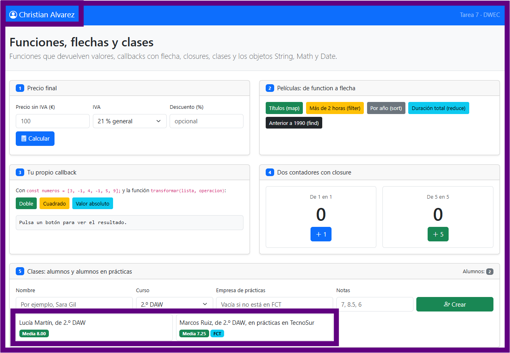
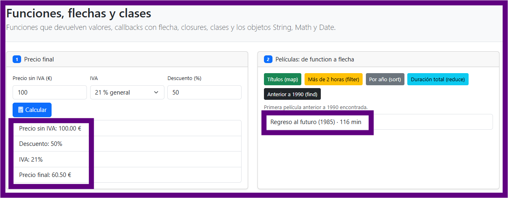
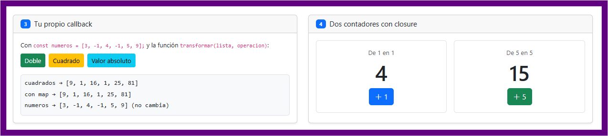
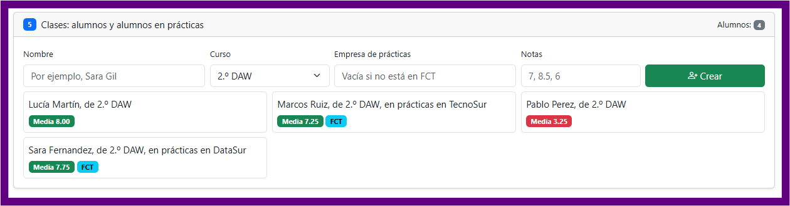
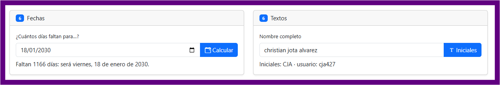

# Tarea 7 · Funciones, flechas y clases

**Autor:** Christian Alvarez · Desarrollo Web en Entorno Cliente (DWEC) · 2.º DAW · Curso 2026-27

<!-- **Plantilla de la tarea 7.** Cómo usarla:
>
> 1. Copia esta carpeta en tu repositorio de DWEC y cámbiale el nombre a `tema07`.
> 2. `index.html` ya está maquetado: una card por ejercicio (el 6 tiene dos). No cambies los `id` ni el `onclick` de los botones.
> 3. `js/app.js` trae una función por botón con `TODO`. Ya están hechas `pintarLista()`, `formatearEuros()`, `pintarAlumnos()` y un modelo en los ejercicios 3, 4 y 6.
> 4. Flechas en todos los callbacks y nunca una flecha como método. Las funciones de los botones, con `function`.
> 5. Sustituye las imágenes de `capturas/` por las tuyas, **con el mismo nombre**.
> 6. Todo lo que va entre [corchetes] es un hueco: cámbialo por lo tuyo. Al terminar, borra este aviso.-->

En esta carpeta se encuentra la solución a la Tarea 7 del módulo DWEC. Para ejecutar la aplicación, abre el proyecto en Visual Studio Code, inicia el servidor local con **Live Server** ("Go Live") y abre `index.html` en el navegador. Abre la consola de desarrollador (F12) para comprobar el rastro de trazabilidad dejado por cada función con `console.log()`.

## Capturas

### a) La página recién cargada

Al cargar la página se observa en la barra de navegación el nombre del estudiante ("Christian Alvarez"). En la sección del Ejercicio 5 se muestra automáticamente los dos alumnos instanciados de partida ("Lucía Martín", objeto de la clase `Alumno`, y "Marcos Ruiz", objeto de la clase `AlumnoFCT`).

### b) Ejercicios 1 y 2: el precio y las películas

Muestra el resultado tras introducir un precio y un descuento en el Ejercicio 1 y pulsar "Calcular". `calcularPrecio()` calcula de forma pura el precio final restando el porcentaje de descuento y sumando el IVA, mientras que `mostrarPrecio()` lee los inputs del formulario, valida que no haya valores negativos, invoca la función de cálculo y pinta el desglose utilizando `pintarLista()`. Además, muestra la primera película anterior a 1990 encontrada del Ejercicio 2.

### c) Ejercicios 3 y 4: tu callback y los contadores

`transformar(lista, operacion)` Emula el comportamiento interno del método nativo `map()` recorriendo el array con un bucle `for...of` e invocando la función `operacion` para cada elemento sin alterar el array original `numeros`. En el Ejercicio 4, al hacer clic en `+1` y `+5`, los contadores se incrementan independientemente debido a que cada uno mantiene su propio estado encerrado a través de un *closure*.

### d) Ejercicio 5: los alumnos

Tarjeta visual con cuatro alumnos creados. El código evalúa el campo de entrada "Empresa de prácticas": si el usuario deja dicha casilla vacía, instancia un objeto de la clase base `Alumno`; si la casilla contiene texto, instancia un objeto de la subclase `AlumnoFCT` pasándole la empresa al constructor. Las notas se limpian, se convierten a número con `map()` y se validan con `some()` antes de asignarse.

### e) Ejercicio 6: fechas y textos

Muestra los días calculados hasta una fecha futura elegida (por ejemplo, el 25/12/2026). La función ajusta la fecha actual a medianoche (`00:00:00`), obtiene la diferencia en milisegundos y la divide por los milisegundos de un día (`1000 * 60 * 60 * 24`). Se aplica `Math.round()` obligatoriamente para corregir las pequeñas desviaciones decimales provocadas por el cambio de horario de verano/invierno. También se aprecian las iniciales generadas en mayúsculas y el identificador de usuario con tres cifras aleatorias completadas con `padStart(3, "0")`.

## Reflexión

El paso de `function` a la notación flecha sintetiza el código, eliminando palabras reservadas e imponiendo un retorno implícito cuando la función se compone de una sola expresión sin llaves. El `return` explícito es obligatorio únicamente cuando el cuerpo de la flecha se delimita entre llaves `{}` o requiere múltiples sentencias; de omitirse en ese caso, la función devolverá `undefined`. Por otro lado, un método dentro de una clase u objeto nunca debe escribirse con función flecha porque las flechas no poseen su propio contexto de `this`, sino que heredan el `this` del ámbito léxico superior (generalmente el objeto global `window` en el navegador). En una clase, un método debe escribirse con la sintaxis corta, asegurando así que `this` apunte a la instancia del objeto.

## Fuentes

- [MDN Web Docs · Funciones flecha](https://developer.mozilla.org/es/docs/Web/JavaScript/Reference/Functions/Arrow_functions)
- [MDN Web Docs · Clases en JavaScript](https://developer.mozilla.org/es/docs/Web/JavaScript/Reference/Classes)
- [MDN Web Docs · Closures](https://developer.mozilla.org/es/docs/Web/JavaScript/Closures)
- [MDN Web Docs · Objeto Date](https://developer.mozilla.org/es/docs/Web/JavaScript/Reference/Global_Objects/Date)
- [Apuntes Tema 07 DWEC · Funciones y objetos](pdf/Tema07.pdf)

## Uso de IA

Se ha utilizado un modelo de lenguaje de Inteligencia Artificial (Gemini) como asistente interactivo durante la realización de la tarea:

- **Resolución de dudas sintácticas y de depuración:** Explicación y adaptación de funciones de respuesta (*callback*) tradicional a la notación de función flecha (*arrow functions*) en métodos iteradores (`map`, `filter`, `sort`, `reduce`, `find`, `some`), resolución de dudas sobre la perseverancia del ámbito (*closure*) en variables locales y ajuste en la sintaxis de herencia de clases (`extends` y `super`).
