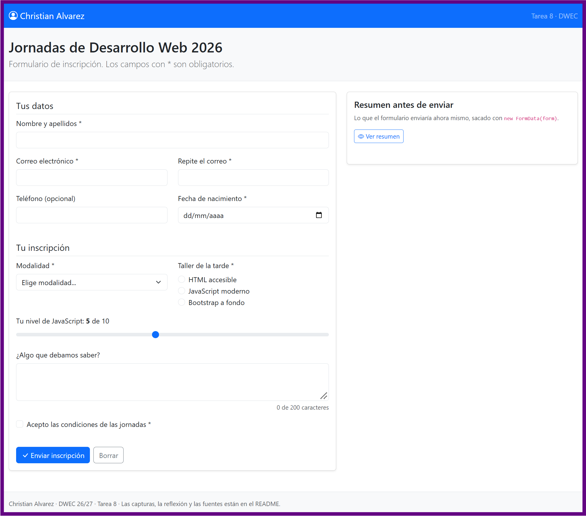
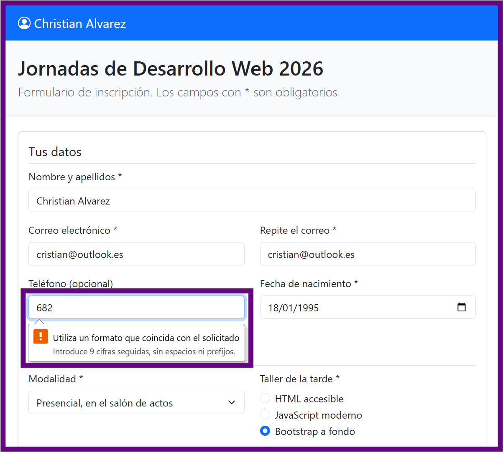
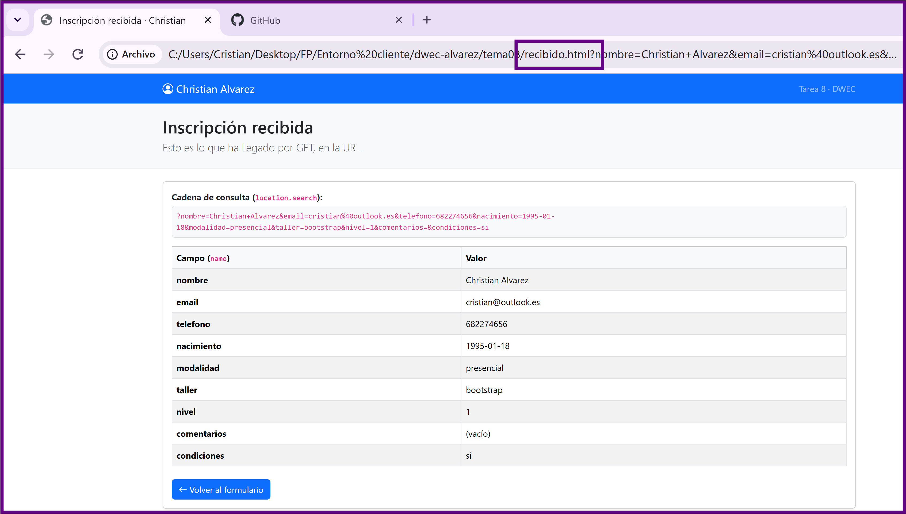
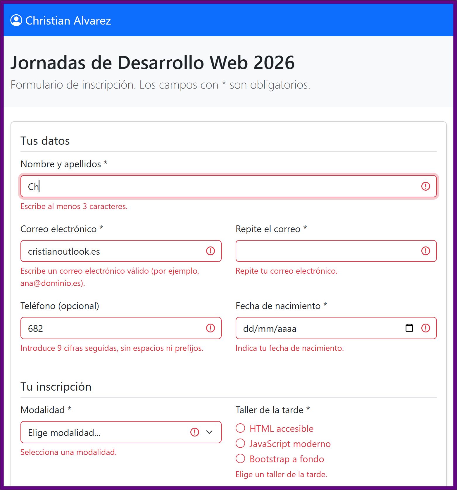
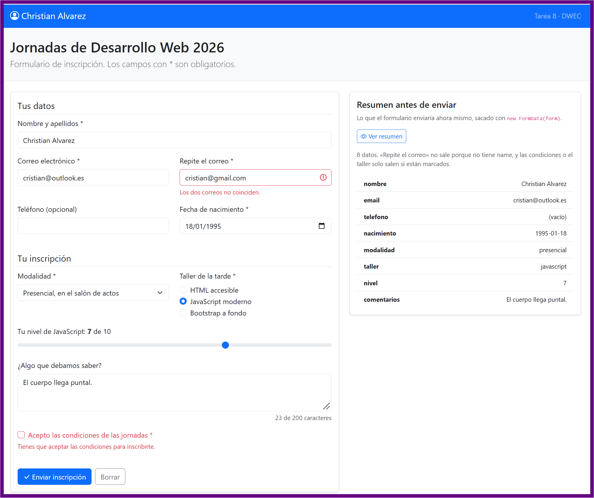

# Tarea 8 · Formulario de inscripción

**Autor:** Christian Alvarez · Desarrollo Web en Entorno Cliente (DWEC) · 2.º DAW · Curso 2026-27

Esta carpeta contiene el formulario de inscripción a las **Jornadas de Desarrollo Web 2026** (`index.html`), su validación y eventos en JavaScript (`js/app.js`), y la página de recepción por GET (`recibido.html` y `js/recibido.js`). Para probarlo, basta con abrir la carpeta en VS Code, iniciar **Live Server** y abrir las herramientas de desarrollador (F12) para ver los mensajes en consola.

## Capturas

### a) La página recién cargada

Vista inicial de `index.html` con mi nombre en la barra de navegación y el pie de página, los dos grupos de campos (`Tus datos` y `Tu inscripción`) maquetados con Bootstrap y la tarjeta lateral del resumen.

### b) Ejercicio 2: el mensaje del navegador

Antes de añadir `novalidate`, al introducir un teléfono de menos de 9 cifras el navegador bloquea el envío y muestra el aviso nativo junto al atributo `title`. Al eliminar `required` desde F12 en un campo obligatorio, el navegador permite enviarlo vacío; por eso el servidor debe validar siempre los datos recibidos, ya que cualquier usuario puede manipular el HTML o enviar peticiones externas sin pasar por el formulario.

### c) Ejercicio 3: lo que llega por GET

En `recibido.html` se muestra `location.search` y la tabla generada con `URLSearchParams`. En la URL viajan en texto plano los pares `name=valor` de los campos rellenados; «Repite el correo» (`email2`) no llega porque carece de atributo `name`. Nunca se enviaría una contraseña por GET porque quedaría visible en la barra de direcciones, en el historial del navegador y en los registros del servidor.

### d) Ejercicio 4: los errores, junto a cada campo

Validación personalizada en JavaScript con cuatro errores distintos: campo vacío (`valueMissing` desde `OBLIGATORIOS`), formato de correo incorrecto (`typeMismatch`), nombre demasiado corto (`tooShort` usando `minLength`) y teléfono fuera de patrón (`patternMismatch` mostrando su `title`).

### e) Ejercicios 5 y 6: eventos y resumen

Funcionamiento en tiempo real: el contador de caracteres de los comentarios actualizado, el valor del deslizador reflejado en `<output>`, el aviso propio mediante `setCustomValidity` al no coincidir los correos y la lista generada con `new FormData(form)`.

## Reflexión

Validar con JavaScript permite controlar cuándo y cómo se muestran los errores, unificando el diseño con Bootstrap, enseñando todos los fallos a la vez sin depender del aspecto distinto de cada navegador y creando reglas cruzadas como comprobar que dos correos coincidan. Sin embargo, ninguna validación en el cliente es suficiente por sí sola, porque el código HTML y JS se ejecuta en el navegador del usuario y puede desactivarse o saltarse fácilmente con F12 o enviando datos directos al servidor. Por último, al usar funciones flecha en el evento `submit`, `this` no apunta al formulario sino al objeto global `window`, por lo que debemos acceder al formulario mediante `e.target`.

## Fuentes

- [Documentación de Bootstrap 5 · Forms](https://getbootstrap.com/docs/5.3/forms/overview/)
- [MDN Web Docs · Validación de formularios de datos](https://developer.mozilla.org/es/docs/Learn_web_development/Extensions/Forms/Form_validation)
- [MDN Web Docs · URLSearchParams](https://developer.mozilla.org/es/docs/Web/API/URLSearchParams)
- [MDN Web Docs · FormData](https://developer.mozilla.org/es/docs/Web/API/FormData)

## Uso de IA

He utilizado Gemini como apoyo para revisar la estructura de los selectores de Bootstrap, resolver dudas sobre el funcionamiento de `setCustomValidity` en los eventos `input` y repasar la redacción de este documento. Posteriormente, he probado y verificado todo el código paso a paso en mi entorno local con la consola del navegador.